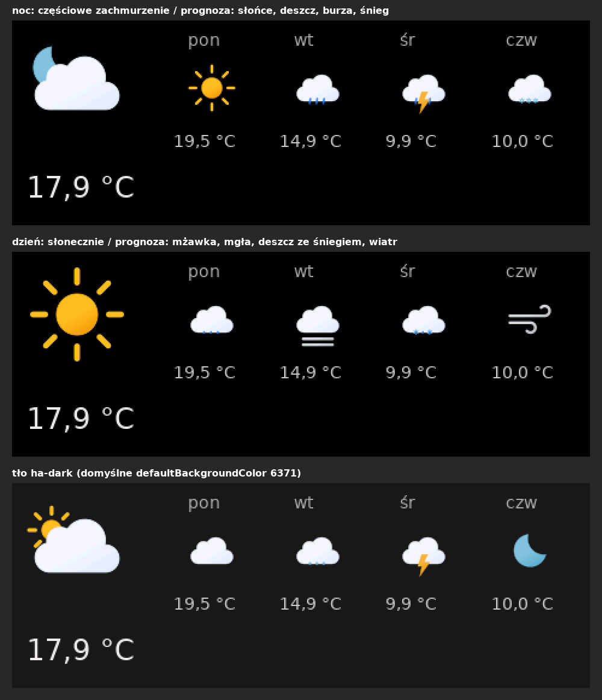

# NSPanel Lovelace UI – Home Assistant integration (fork by Szymi)

Polski: [README.pl.md](README.pl.md)

> [!IMPORTANT]
> **This is an unofficial fork** of [joBr99/nspanel-lovelace-ui](https://github.com/joBr99/nspanel-lovelace-ui)
> by joBr99 and its contributors. The Lovelace UI firmware design, the panel protocol, the card types and
> the configuration format come from the original project – all credit for them goes there.
> This fork is not affiliated with or supported by the original project: please report problems with this
> fork [here](https://github.com/franekSoftSF/nspanel-lovelace-ui/issues), not upstream.

NSPanel Lovelace UI is a firmware for the Nextion screen of the Sonoff NSPanel in the design of Home
Assistant's Lovelace UI. This fork drives it with a **native Home Assistant integration** and ships its
own **display firmware 55** with Material Design Icons 7 and colour weather pictures.

## What this fork adds

- **Native Home Assistant integration** (`custom_components/nspanel_lovelace_ui`) – no AppDaemon, no
  add-on, no access token, no second MQTT connection. Runs on every installation type (OS, Supervised,
  Container, Core). Installs from the Marketplace that replaced HACS in Home Assistant 2026.11.
- **Migration from the AppDaemon / HACS version** in the setup dialog: it finds your AppDaemon `apps.yaml`,
  converts it (including `!secret` values), and switches the old AppDaemon app off (with a backup) –
  step by step in [MIGRATION.md](MIGRATION.md).
- **Display firmware 55 (EU only, see below)**: Material Design Icons 7.4.47 (7447 icons), a 64 px icon
  font, colour weather pictures (Meteocons) with its own icon and colour for every forecast day and night
  variants, `°` in the clock font, notifications that hide the pictures.
- **Remote updates over Wi-Fi** from Home Assistant: the integration downloads the firmware package of its
  release from GitHub (SHA-256 checked), updates the Tasmota Berry driver (action
  `nspanel_lovelace_ui.update_berry_driver`) and flashes the display from an update entity with progress
  – no cable, no manual `FlashNextion`.
- **Card editor** in the Home Assistant sidebar: forms for every card type, validation at the field while
  you type, Save (with backups) and Reload panels – no YAML needed. See [INTEGRATION.md](INTEGRATION.md#card-editor).
- **Charts**: bar (`cardChart`) and line (`cardLChart`) charts from the Home Assistant history – the original
  project had only a draft. See [INTEGRATION.md](INTEGRATION.md#charts).
- **Entities and notifications**: `notify.send_message` to the panel (screensaver text or a notification
  page, buzzer), sleep and wake actions for automations (e.g. screen off when the alarm is armed), the current page and a card selector – see [INTEGRATION.md](INTEGRATION.md).
- **Fixes for issues of the original project** (table below) and for problems found while migrating a
  real panel.
- Tests with `pytest-homeassistant-custom-component` (185 tests), documentation in English and Polish.

## Display firmware: EU model only

The display firmware 55 of this fork is built **only for the EU model** (NX4832F035, 3.5", landscape).

- **EU:** firmware 55 – everything above.
- **US portrait / US landscape:** not built. The integration works with the original US firmware
  (53/54), without the colour weather pictures and the new icons. The firmware 55 changes for the US
  variants are prepared in [HMI/patches/55](HMI/patches/55) and described in
  [HMI/BUILD-55.en.md](HMI/BUILD-55.en.md), but nobody has compiled and tested them yet.

## Issues of the original project fixed in this fork

| Issue | Fix | Version |
|---|---|---|
| [#1480](https://github.com/joBr99/nspanel-lovelace-ui/issues/1480) | Duplicate keys in `panels.yaml` only warn (line number in Repairs) | 5.1.0 |
| [#1465](https://github.com/joBr99/nspanel-lovelace-ui/issues/1465) | Panels wake up only for entities they use | 5.1.0 |
| [#1470](https://github.com/joBr99/nspanel-lovelace-ui/issues/1470) | `navItem1` / `navItem2` with `entity` replace the navigation buttons | 5.1.0 |
| [#1405](https://github.com/joBr99/nspanel-lovelace-ui/issues/1405) | `timeTemplate` instead of the clock; `°` in the clock font | 5.2.0 |
| [#1190](https://github.com/joBr99/nspanel-lovelace-ui/issues/1190) | Grid layout follows the number of *visible* entities | 5.2.0 |
| [#995](https://github.com/joBr99/nspanel-lovelace-ui/issues/995) | Flash progress and errors in Home Assistant (Berry driver 10) | 5.2.0 |
| [#1026](https://github.com/joBr99/nspanel-lovelace-ui/issues/1026) | Status icons redrawn after a colour change (EU firmware 55) | 5.2.0 |
| [#1485](https://github.com/joBr99/nspanel-lovelace-ui/issues/1485) | Time with AM/PM no longer runs under AM/PM (EU firmware 55) | 5.2.0 |

Prepared for the US firmware only (not built): [#1456](https://github.com/joBr99/nspanel-lovelace-ui/issues/1456),
[#1475](https://github.com/joBr99/nspanel-lovelace-ui/issues/1475). Full list of changes: [INTEGRATION.md](INTEGRATION.md#changelog).

## Installation

Requirements: Home Assistant 2026.10 or newer, the NSPanel flashed with Tasmota (Berry driver) and the
Home Assistant MQTT integration – or ESPHome with `use_ha_api: true`.

- **Marketplace (Home Assistant 2026.11+):** Settings → Marketplace → *Add from link* →
  `franekSoftSF/nspanel-lovelace-ui`.
- **HACS (older Home Assistant):** custom repository `https://github.com/franekSoftSF/nspanel-lovelace-ui`,
  type *Integration*.
- **Manual:** copy `custom_components/nspanel_lovelace_ui` from a
  [release](https://github.com/franekSoftSF/nspanel-lovelace-ui/releases) to `<config>/custom_components/`.

Then: Settings → Devices & services → *Add integration* → **NSPanel Lovelace UI**. Full guide:
[INTEGRATION.md](INTEGRATION.md); moving from AppDaemon / HACS: [MIGRATION.md](MIGRATION.md).

## Remote updates

1. The integration downloads the firmware package of its own release (`nspanel-firmware.zip`).
2. Berry driver: action `nspanel_lovelace_ui.update_berry_driver` (an `autoexec.be` install moves to `.tapp`).
3. Display: each panel has an update entity **Display firmware** – *Install*; the entity shows the
   progress and the panel restarts with the new version.

Details: [HMI/FIRMWARE.md](HMI/FIRMWARE.md).

## Configuration

`<config>/nspanel_lovelace_ui/panels.yaml` uses the same format as the original project, so its
documentation of the cards and the screensaver applies: <https://docs.nspanel.pky.eu/>. Options added in
this fork (`weatherIcons`, `timeTemplate`, `firmware_download`, …): [INTEGRATION.md](INTEGRATION.md).

Example configuration: [examples/panels.yaml](examples/panels.yaml). This repository contains only the
integration and the EU firmware; the original add-on, AppDaemon app and other backends live in the
[original project](https://github.com/joBr99/nspanel-lovelace-ui).

## License and credits

- Like the original project, this fork is licensed under the [GNU General Public License v3.0](LICENSE).
- Fork maintained and modified by **Szymi** ([franekSoftSF](https://github.com/franekSoftSF)), 2026 – what was changed: [NOTICE](NOTICE).
- Original project: [joBr99/nspanel-lovelace-ui](https://github.com/joBr99/nspanel-lovelace-ui) – joBr99 and contributors.
- Weather pictures: [Meteocons](https://github.com/basmilius/weather-icons) by Bas Milius (MIT).
- Icons: [Material Design Icons](https://pictogrammers.com/library/mdi/) by Pictogrammers.
- Clock font `°`: Noto Sans (SIL Open Font License).
