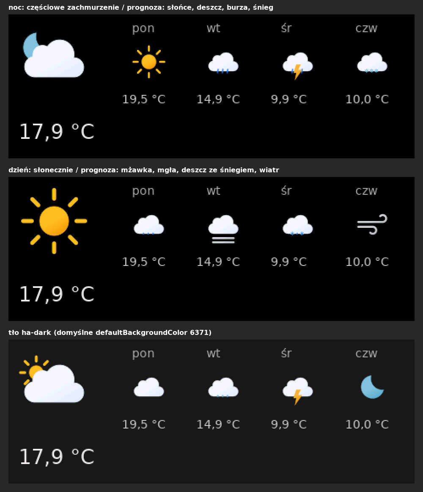

# NSPanel Lovelace UI – integracja Home Assistant (fork by Szymi)

English: [README.md](README.md)

> [!IMPORTANT]
> **To nieoficjalny fork** projektu [joBr99/nspanel-lovelace-ui](https://github.com/joBr99/nspanel-lovelace-ui)
> autorstwa joBr99 i współtwórców. Wygląd firmware Lovelace UI, protokół panelu, typy kart i format
> konfiguracji pochodzą z oryginalnego projektu – to jego zasługa.
> Ten fork nie jest powiązany z oryginalnym projektem ani przez niego wspierany: problemy z tym forkiem
> zgłaszaj [tutaj](https://github.com/franekSoftSF/nspanel-lovelace-ui/issues), nie w oryginalnym repozytorium.

NSPanel Lovelace UI to firmware ekranu Nextion w Sonoff NSPanel w stylu Lovelace UI z Home Assistant.
Ten fork steruje nim **natywną integracją Home Assistant** i ma własne **firmware ekranu 55** z ikonami
Material Design Icons 7 i kolorowymi obrazkami pogody.

## Co dodaje ten fork

- **Natywna integracja Home Assistant** (`custom_components/nspanel_lovelace_ui`) – bez AppDaemon, bez
  dodatku, bez tokenu dostępu, bez drugiego połączenia MQTT. Działa na każdym typie instalacji (OS,
  Supervised, Container, Core). Instalacja z Marketplace, który w Home Assistant 2026.11 zastąpił HACS.
- **Przejście z wersji AppDaemon / HACS** w oknie konfiguracji: kreator sam znajduje `apps.yaml` z
  AppDaemon, konwertuje go (razem z wartościami `!secret`) i wyłącza starą aplikację AppDaemon (z kopią
  zapasową) – krok po kroku w [MIGRATION.pl.md](MIGRATION.pl.md).
- **Firmware ekranu 55 (tylko EU, patrz niżej)**: Material Design Icons 7.4.47 (7447 ikon), font ikon
  64 px, kolorowe obrazki pogody (Meteocons) z własną ikoną i kolorem dla każdego dnia prognozy i
  wariantami nocnymi, znak `°` w foncie zegara, powiadomienia chowające obrazki.
- **Zdalna aktualizacja przez Wi-Fi** z Home Assistant: integracja pobiera z GitHuba pakiet firmware
  swojego wydania (sprawdzany SHA-256), aktualizuje sterownik Berry w Tasmocie (akcja
  `nspanel_lovelace_ui.update_berry_driver`) i wgrywa firmware ekranu z encji aktualizacji z postępem –
  bez kabla i bez ręcznego `FlashNextion`.
- **Edytor kart** w menu bocznym Home Assistant: formularze dla każdego typu karty, walidacja przy polu
  w trakcie pisania, Zapisz (z kopiami zapasowymi) i Przeładuj panele – bez YAML. Patrz
  [INTEGRATION.pl.md](INTEGRATION.pl.md#edytor-kart).
- **Encje i powiadomienia**: `notify.send_message` na panel (tekst na wygaszaczu albo strona powiadomienia,
  buzzer), przycisk budzenia ekranu, aktualna strona i wybór karty – patrz [INTEGRATION.pl.md](INTEGRATION.pl.md).
- **Poprawki zgłoszeń z oryginalnego projektu** (tabela niżej) i problemów znalezionych przy migracji
  prawdziwego panelu.
- Testy z `pytest-homeassistant-custom-component` (173 testy), dokumentacja po angielsku i po polsku.

## Firmware ekranu: tylko model EU

Firmware ekranu 55 z tego forka jest zbudowane **tylko dla modelu EU** (NX4832F035, 3,5", poziomo).

- **EU:** firmware 55 – wszystko, co opisano wyżej.
- **US pionowy / US poziomy:** niezbudowane. Integracja działa z oryginalnym firmware US (53/54), bez
  kolorowych obrazków pogody i nowych ikon. Zmiany firmware 55 dla wariantów US są przygotowane w
  [HMI/patches/55](HMI/patches/55) i opisane w [HMI/BUILD-55.md](HMI/BUILD-55.md), ale nikt ich jeszcze
  nie skompilował ani nie przetestował.

## Poprawione zgłoszenia z oryginalnego projektu

| Zgłoszenie | Poprawka | Wersja |
|---|---|---|
| [#1480](https://github.com/joBr99/nspanel-lovelace-ui/issues/1480) | Zduplikowane klucze w `panels.yaml` dają tylko ostrzeżenie (z numerem linii w Naprawach) | 5.1.0 |
| [#1465](https://github.com/joBr99/nspanel-lovelace-ui/issues/1465) | Panele budzą się tylko przy zmianach używanych encji | 5.1.0 |
| [#1470](https://github.com/joBr99/nspanel-lovelace-ui/issues/1470) | `navItem1` / `navItem2` z `entity` zastępują przyciski nawigacji | 5.1.0 |
| [#1405](https://github.com/joBr99/nspanel-lovelace-ui/issues/1405) | `timeTemplate` zamiast zegara; znak `°` w foncie zegara | 5.2.0 |
| [#1190](https://github.com/joBr99/nspanel-lovelace-ui/issues/1190) | Układ siatki według liczby *widocznych* encji | 5.2.0 |
| [#995](https://github.com/joBr99/nspanel-lovelace-ui/issues/995) | Postęp i błędy wgrywania firmware w Home Assistant (sterownik Berry 10) | 5.2.0 |
| [#1026](https://github.com/joBr99/nspanel-lovelace-ui/issues/1026) | Ikony statusu odświeżane po zmianie koloru (firmware EU 55) | 5.2.0 |
| [#1485](https://github.com/joBr99/nspanel-lovelace-ui/issues/1485) | Godzina z AM/PM nie wchodzi pod napis AM/PM (firmware EU 55) | 5.2.0 |

Przygotowane tylko dla firmware US (niezbudowane): [#1456](https://github.com/joBr99/nspanel-lovelace-ui/issues/1456),
[#1475](https://github.com/joBr99/nspanel-lovelace-ui/issues/1475). Pełna lista zmian: [INTEGRATION.pl.md](INTEGRATION.pl.md#historia-zmian).

## Instalacja

Wymagania: Home Assistant 2026.10 lub nowszy, NSPanel z Tasmotą (sterownik Berry) i integracja MQTT w
Home Assistant – albo ESPHome z `use_ha_api: true`.

- **Marketplace (Home Assistant 2026.11+):** Ustawienia → Marketplace → *Dodaj z linku* →
  `franekSoftSF/nspanel-lovelace-ui`.
- **HACS (starszy Home Assistant):** własne repozytorium `https://github.com/franekSoftSF/nspanel-lovelace-ui`,
  typ *Integracja*.
- **Ręcznie:** skopiuj `custom_components/nspanel_lovelace_ui` z
  [wydania](https://github.com/franekSoftSF/nspanel-lovelace-ui/releases) do `<config>/custom_components/`.

Potem: Ustawienia → Urządzenia i usługi → *Dodaj integrację* → **NSPanel Lovelace UI**. Pełny opis:
[INTEGRATION.pl.md](INTEGRATION.pl.md); przejście z AppDaemon / HACS: [MIGRATION.pl.md](MIGRATION.pl.md).

## Zdalna aktualizacja

1. Integracja pobiera pakiet firmware swojego wydania (`nspanel-firmware.zip`).
2. Sterownik Berry: akcja `nspanel_lovelace_ui.update_berry_driver` (instalacja `autoexec.be` przechodzi na `.tapp`).
3. Ekran: każdy panel ma encję aktualizacji **Firmware ekranu** – *Zainstaluj*; encja pokazuje postęp,
   a panel uruchamia się z nową wersją.

Szczegóły: [HMI/FIRMWARE.pl.md](HMI/FIRMWARE.pl.md).

## Konfiguracja

`<config>/nspanel_lovelace_ui/panels.yaml` ma ten sam format co w oryginalnym projekcie, więc jego
dokumentacja kart i wygaszacza nadal obowiązuje: <https://docs.nspanel.pky.eu/>. Opcje dodane w tym
forku (`weatherIcons`, `timeTemplate`, `firmware_download`, …): [INTEGRATION.pl.md](INTEGRATION.pl.md).

Przykładowa konfiguracja: [examples/panels.yaml](examples/panels.yaml). To repozytorium zawiera tylko
integrację i firmware EU; oryginalny dodatek, aplikacja AppDaemon i inne backendy są w
[oryginalnym projekcie](https://github.com/joBr99/nspanel-lovelace-ui).

## Licencja i podziękowania

- Tak jak oryginalny projekt, ten fork jest na licencji [GNU General Public License v3.0](LICENSE).
- Fork prowadzi i zmienia **Szymi** ([franekSoftSF](https://github.com/franekSoftSF)), 2026 – co zostało zmienione: [NOTICE](NOTICE).
- Oryginalny projekt: [joBr99/nspanel-lovelace-ui](https://github.com/joBr99/nspanel-lovelace-ui) – joBr99 i współtwórcy.
- Obrazki pogody: [Meteocons](https://github.com/basmilius/weather-icons), Bas Milius (MIT).
- Ikony: [Material Design Icons](https://pictogrammers.com/library/mdi/), Pictogrammers.
- Znak `°` w zegarze: Noto Sans (SIL Open Font License).
